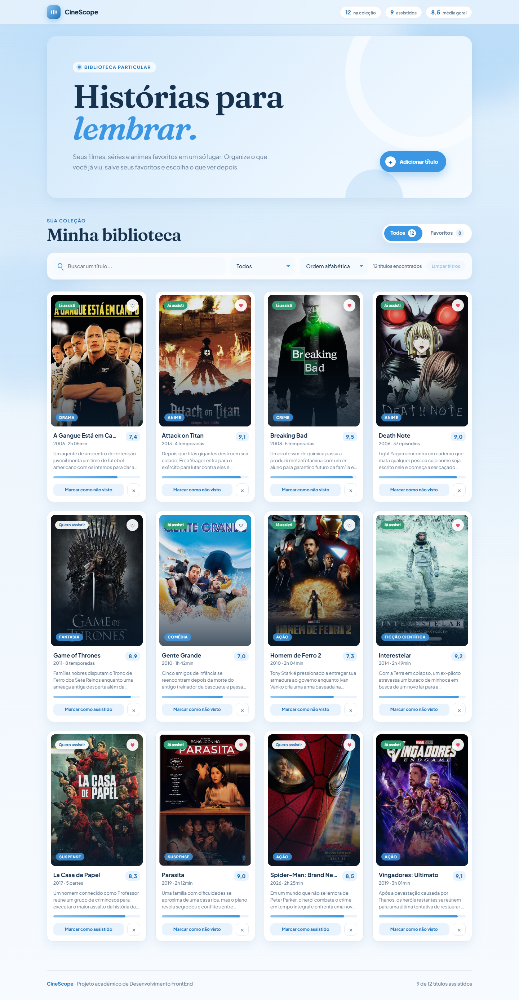
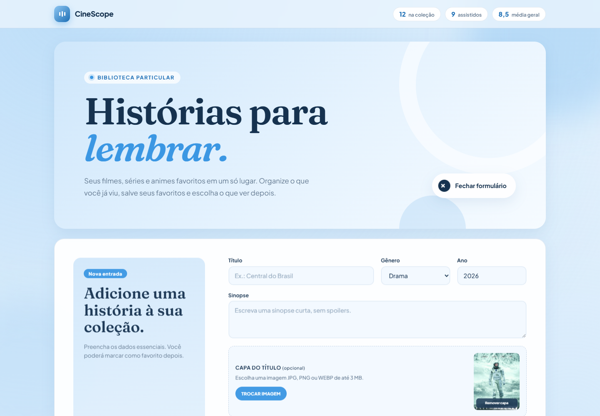
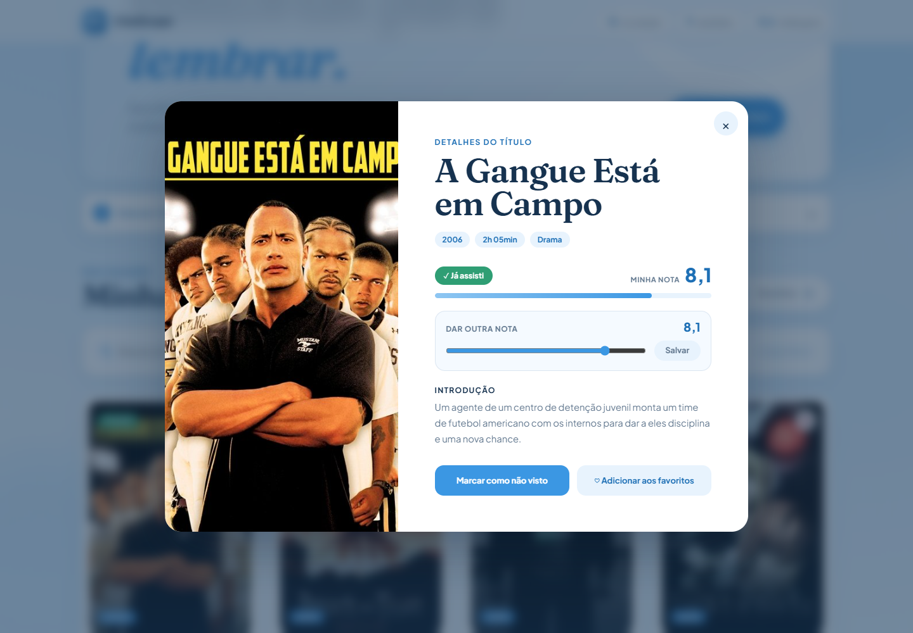

# CineScope

Trabalho do 1º bimestre de Desenvolvimento FrontEnd (UNIPAR, prof. Paulo).

Tema escolhido: **2.4 Galeria de filmes e séries**. É uma biblioteca pessoal de filmes, séries e animes onde dá para buscar pelo título, filtrar por gênero, ordenar (a lista já começa em ordem alfabética), favoritar, marcar como assistido, dar nota, cadastrar um título com capa e remover.



O formulário aceita uma imagem de capa e mostra a prévia antes do cadastro:



Clicando no cartaz abre uma janela com os detalhes do título, onde também dá para mudar a nota:



## Como rodar

```bash
npm install
npm start
```

Depois é só abrir `http://localhost:4200`.

## Componentes

- `App` (raiz): guarda a lista, a busca, os filtros e a janela de detalhes
- `AppHeaderComponent`: cabeçalho com total de filmes, assistidos e média das notas (recebe tudo por `@Input`)
- `MovieCardComponent`: o card de cada filme, avisa o `App` dos cliques com `@Output`
- `MovieFormComponent`: formulário de cadastro de filme novo
- `MovieService`: onde fica o array com os 12 títulos iniciais (em ordem alfabética) e as funções de adicionar, remover e alterar

## Onde está cada requisito

| Requisito                      | Onde                                                                                                                                              |
| ------------------------------ | ------------------------------------------------------------------------------------------------------------------------------------------------- |
| `ng new` sem SSR e sem routing | projeto criado pelo Angular CLI, sem `app.routes.ts`                                                                                              |
| Interpolação `{{ }}`           | título, ano, duração/temporadas, nota e gênero no card; totais no header; contadores e mensagens no `app.html`                                    |
| Property binding `[ ]`         | `[disabled]` no botão do formulário e no Salvar da nota, `[src]` nos cartazes, `[class.is-active]` nas abas                                       |
| Event binding `( )`            | `(click)` para adicionar, remover, favoritar, marcar como assistido e salvar a nota                                                               |
| `[(ngModel)]`                  | busca, filtro de gênero, ordenação, todos os campos do formulário e o slider de nota (`FormsModule` importado no `App` e no `MovieFormComponent`) |
| `@if`                          | "Já assisti" / "Quero assistir", formulário aberto/fechado, mensagens, erros dos campos, lista vazia                                              |
| `@for`                         | lista com 12 títulos no array do `MovieService` e as opções dos selects                                                                           |
| CSS                            | estilo global em `styles.css` e um CSS para cada componente, com layout responsivo                                                                |

## Observações

- Os dados ficam só na memória, então ao recarregar a página a lista volta ao início.
- O projeto possui 9 testes automatizados, executados com `npm test -- --watch=false`.
- No cadastro, é possível escolher uma capa JPG, PNG ou WEBP de até 3 MB. Sem imagem, o título recebe uma capa desenhada na cor do gênero.
- As capas foram usadas só para este trabalho acadêmico (fonte: The Movie Database - TMDB, AdoroCinema e Sony Pictures).
